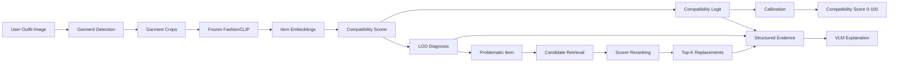

# Fashion Outfit Compatibility System

> A system for evaluating an outfit's compatibility, identifying items that may disrupt its balance, suggesting replacements, and providing explanations that are easy for users to understand.

---

## Overview

The project builds a modular, architecture-neutral **Fashion Outfit Compatibility** pipeline.

Its main goals are to:

- score an outfit's **overall compatibility**;
- support **diagnosis** to identify the item with the greatest negative impact;
- support **recommendation** to suggest replacement items;
- produce **structured evidence** for a VLM to generate explanations;
- keep the pipeline flexible enough to change the scorer without replacing the entire system.

### Current delivery scope

The canonical delivery currently uses the frozen V5 scorer, LOO diagnosis, and grounded VLM explanations. Garment detection is being developed in parallel. Candidate retrieval and replacement recommendation have not been implemented and remain future work; the VLM must not invent recommendations to fill this gap.

The core scorer always returns:

```text
compatibility_logit
```

After calibration, the system can produce:

```text
compatibility_score ∈ [0, 100]
```

> `compatibility_score` is calibrated by the system from the model output. It is not a "percentage of beauty" or an objective fashion assessment.

---

## Pipeline



---

## Main Components

### 1. Data Processing

The dataset is built from `codewaly/polyvore1000`.

Positive sample:

```text
label = 1
→ original outfit
```

Negative V1:

```text
label = 0
negative_type = same_category_different_kit
```

A negative sample is created by replacing exactly one item with another item that:

- has the same `master_category`;
- has a different `item_id`;
- comes from a different kit;
- is not already present in the current outfit.

Dataset V1 maintains a ratio of:

```text
Positive : Negative = 1 : 1
```

Selected statistics from the current preprocessing:

| Property | Value |
|---|---:|
| Unique items | 114,806 |
| Kits | 17,316 |
| Categories | 363 |
| Positive samples | 17,316 |
| Negative samples | 17,316 |

Negative V1 currently uses **category-preserving negatives**, not true style-aware hard negatives.

---

### 2. FashionCLIP Embedding

Each `item_id` maps to a FashionCLIP embedding:

```text
item_id
  ↓
Frozen FashionCLIP image encoder
  ↓
512-d embedding
  ↓
L2 normalization
```

Contract V1:

| Property | Value |
|---|---|
| Encoder | Frozen FashionCLIP |
| Dimension | 512 |
| Normalization | L2-normalized |
| Cache precision | FP16 is allowed |
| Lookup key | `item_id` |

Embeddings are stored outside JSONL to avoid duplication and support reuse across scorers.

---

### 3. Compatibility Scorer

The scorer requires at least:

```text
item_embeddings
item_mask
```

Type-aware architectures may also use:

```text
master_category_ids
coarse_category_ids
```

Required output:

```json
{
  "compatibility_logit": 1.73
}
```

The project does not lock the scorer to a particular architecture. Possible experiments include:

- Mean Pooling;
- Type-aware Pairwise;
- graph- or hypergraph-based models;
- other scorers in the future.

Pairwise evidence, attention weights, and item contributions are **optional diagnostics**, not part of the core contract.

---

### 4. Leave-One-Out Diagnosis

Diagnosis uses Leave-One-Out to identify the item most likely to reduce compatibility.

For an outfit $O$:

```text
1. Compute the original score C(O)
2. Remove each item in turn
3. Recompute the score
4. Calculate the delta
5. Rank items by delta
```

Formula:

$$
\Delta_i = C(O \setminus x_i) - C(O)
$$

The item with the largest $\Delta_i$ is considered the problematic item:

$$
\hat y = \arg\max_i \Delta_i
$$

Synthetic negatives include `swapped_item_index`, allowing diagnosis to be evaluated quantitatively.

---

### 5. Recommendation

Recommendation is divided into two stages:

```text
Problematic Item
      ↓
Candidate Retrieval
      ↓
Top-200 candidates
      ↓
Compatibility Scorer Reranking
      ↓
Top-5 replacements
```

Candidate retrieval aims to produce a high-recall shortlist.

Scorer reranking aims to choose candidates that make the outfit more compatible in the context of the entire outfit.

Recommendation is a separate branch after the scorer; the VLM does not select candidates directly.

---

### 6. VLM Explanation

The VLM is not the primary source of the compatibility score.

It receives structured evidence from the pipeline, for example:

```json
{
  "schema_version": "vlm-evidence-v1",
  "scorer": {
    "compatibility_logit": -0.31,
    "semantics": "uncalibrated_logit_not_probability"
  },
  "diagnosis": {
    "problematic_item_index": 2,
    "problematic_item_id": "item_002",
    "top1_top2_delta_gap": 0.18
  },
  "recommendation": {
    "status": "not_implemented",
    "items": []
  }
}
```

The VLM then turns this evidence into a natural-language explanation for the user.

VLM V1 uses `Qwen/Qwen3-VL-4B-Instruct` under the contract in `docs/VLM_EXPLANATION_V1.md`. Qwen only outputs visual-analysis enums from a closed taxonomy; the code then renders Vietnamese text using reviewed templates. Because no free text is accepted from Qwen, the validator can reject any attempt to insert a replacement suggestion. The problematic item selected by LOO is authoritative, and recommendation always retains `status = not_implemented`.

The goal is to keep:

```text
Scoring
≠
Explanation
```

so that explanations do not change the scorer's decision.

---

## Data Contract

The project uses canonical scorer-ready JSONL.

Positive:

```json
{
  "sample_id": "214181831_pos",
  "source_kit_id": "214181831",
  "items": [
    "214181831_1",
    "214181831_2",
    "214181831_3"
  ],
  "label": 1,
  "negative_metadata": null
}
```

Negative:

```json
{
  "sample_id": "214181831_neg_1",
  "source_kit_id": "214181831",
  "items": [
    "214181831_1",
    "987654321_2",
    "214181831_3"
  ],
  "label": 0,
  "negative_metadata": {
    "negative_type": "same_category_different_kit",
    "swapped_item_index": 1,
    "original_item_id": "214181831_2",
    "replacement_item_id": "987654321_2",
    "swap_category": "example_master_category",
    "replacement_kit_id": "987654321"
  }
}
```

Components are versioned independently:

```text
dataset_version
negative_protocol_version
category_mapping_version
embedding_version
scorer_version
calibration_version
```

---

## Evaluation

### Compatibility Scorer

Primary:

- **ROC-AUC**
- **2-way FITB**

Secondary:

- mean logit margin;
- median logit margin;
- F1-score.

### Recommendation — Retrieval

Primary:

- **Recall@200**

Secondary:

- Recall@100;
- Recall@50.

### Recommendation — Reranking

Primary:

- **Recall@5**

Secondary:

- Recall@1;
- Recall@3;
- Recall@10;
- Replacement Success Rate.

### Diagnosis

Primary:

- **LOO Top-1 Localization Accuracy**

Secondary:

- LOO Hit@2.

---

## Why Multiple Metrics?

Each module answers a different question:

| Module | Main Question | Primary Metric |
|---|---|---|
| Scorer | Is the outfit compatible? | ROC-AUC |
| Paired ranking | Is the original better than a one-item-swap negative? | 2-way FITB |
| Diagnosis | Does it correctly identify the swapped or problematic item? | LOO Top-1 |
| Retrieval | Does the ground-truth item reach the candidate shortlist? | Recall@200 |
| Reranking | Does the ground-truth item reach the final shortlist? | Recall@5 |

---

## Suggested Repository Structure

```text
project/
├── docs/
│   ├── DATA_CONTRACT_VI.md
│   ├── PROJECT_METRICS_VI.md
│   └── TEAM_WORKFLOW_VI.md
│
├── src/
│   ├── data/
│   ├── scorer/
│   ├── diagnosis/
│   ├── recommendation/
│   ├── detection/
│   ├── vlm/
│   └── evaluation/
│
├── configs/
├── notebooks/
│   └── experiments/
├── tests/
├── README.md
└── .gitignore
```

---

## Development Principles

1. **The Data Contract is the source of truth** for data and scorer I/O.
2. Once Dataset V1 is frozen, it must not be silently regenerated for each experiment.
3. Scorers must be compared on the same benchmark before concluding that an architecture is better.
4. FashionCLIP embeddings are frozen and reused across experiments when a fair comparison is needed.
5. Notebooks are for exploration; selected logic must be moved into `src/`.
6. Large artifacts such as datasets, embedding caches, and checkpoints should not be committed directly to GitHub.
7. Raw compatibility logits must not be interpreted directly as a "percentage of beauty."
8. The explanation layer must remain modular and must not lock the project to a particular scorer.

---

## Research Direction

The project draws on several research directions in outfit compatibility:

- **Pairwise / type-aware compatibility**: learning relationships between items rather than only aggregating features.
- **Outfit-level modeling**: modeling an outfit as a set of items rather than a fixed sequence.
- **Graph / Hypergraph modeling**: using category relationships and higher-order interactions.
- **Outlier detection / diagnosis**: identifying items that reduce overall compatibility.
- **Complementary item retrieval**: retrieving candidates from the embedding space and reranking them in the outfit's context.
- **Vision-Language explanation**: using multimodal models or LLMs to generate evidence-based explanations.

---

## Current Status

The main components are being developed independently while sharing the same Data Contract:

```text
Data Processing
Scorer
Diagnosis
Recommendation
Detection
VLM Explanation
Evaluation
```

The eventual goal is an end-to-end pipeline that can:

```text
Evaluate an outfit
      ↓
Identify the problematic item
      ↓
Suggest replacement items
      ↓
Explain the result
```

---

## Internal Documentation

- `DATA_CONTRACT_VI.md` — the source of truth for data, embeddings, scorer I/O, and versioning.
- `PROJECT_METRICS_VI.md` — metric definitions for scoring, diagnosis, and recommendation.
- `TEAM_WORKFLOW_VI.md` — the collaboration workflow between the leader and assistants.

---

## Disclaimer

Fashion compatibility is subjective.

The system's scores reflect patterns learned from the dataset and the current evaluation protocol. They do not represent an objective or universal fashion standard.
